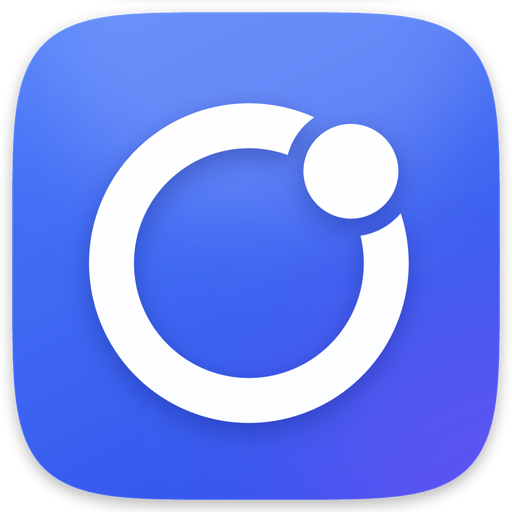

# Orbit

**Your own AI workspace, on your own Mac.** Run any model through the real Claude Code or
Codex agent, let chats hand work to each other, give a chat a goal and let it keep going,
and queue or schedule messages for later. Your chats, notes and files stay in one folder
on the Mac. Use it as [Orbit for Mac](#the-desktop-app), in any browser, or from the
[iPhone app](#on-your-phone), which now reaches your Mac from any network without a VPN.
Other agents (Claude Code, Claude Science, Codex) can [use Orbit as a helper](#orbit-as-a-helper-for-other-agents),
a team can work in a [shared project](#shared-projects), and a builder and a reviewer can
[improve a project for days](#crew-builders-and-reviewers-that-keep-going).

**New to Orbit?** The [user guide](web/guide.md) walks through everything. It is also inside
Orbit: type `/guide`, or open ⋯ More → *User guide*. In the Mac app it is under Help → *Orbit Guide*,
and on the iPhone under Settings → *User guide*.

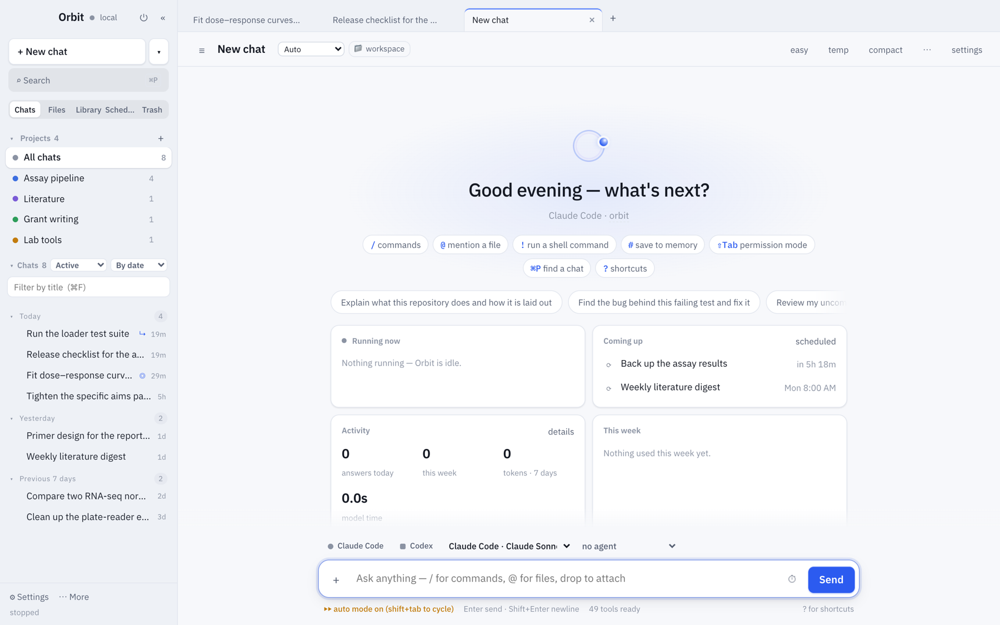

---

## What makes Orbit different

### Claude Code and Codex, on any model

Claude Code and Codex are excellent agents, but each is tied to one company's models.
Orbit runs the **real Claude Code harness** on whatever model you pick:

- your Claude subscription, with no API key (and several accounts, with automatic switching);
- DeepSeek, Kimi, GLM, Qwen or MiniMax;
- Gemini, with the model list and token limits read from Google;
- OpenCode Go (several accounts here too);
- a local MLX model.

A built-in gateway translates between the APIs. You get Claude Code's tools, skills,
subagents, plugins, MCP servers, permission modes and `CLAUDE.md` memory, with every step
shown and every approval answered in Orbit. **Codex mode** does the same with OpenAI's
Codex agent, on your ChatGPT account or any provider. A chat can switch between Orbit's own
agent, Claude Code and Codex and keep its conversation. [More](#claude-code-mode)

### Chats that talk to each other

A chat can **start other chats and hand them work**: a routine test run goes to a cheap,
fast model while the expensive one keeps thinking. A chat can also message an existing
chat, wait for its answer and set goals on the chats it started. Each chat lists the
chats it is talking to. Messages one chat sends another are marked **from** the
sender, with a link back, and you can join any of those chats yourself. [More](#chats-that-talk-to-each-other)

<table><tr>
<td width="50%">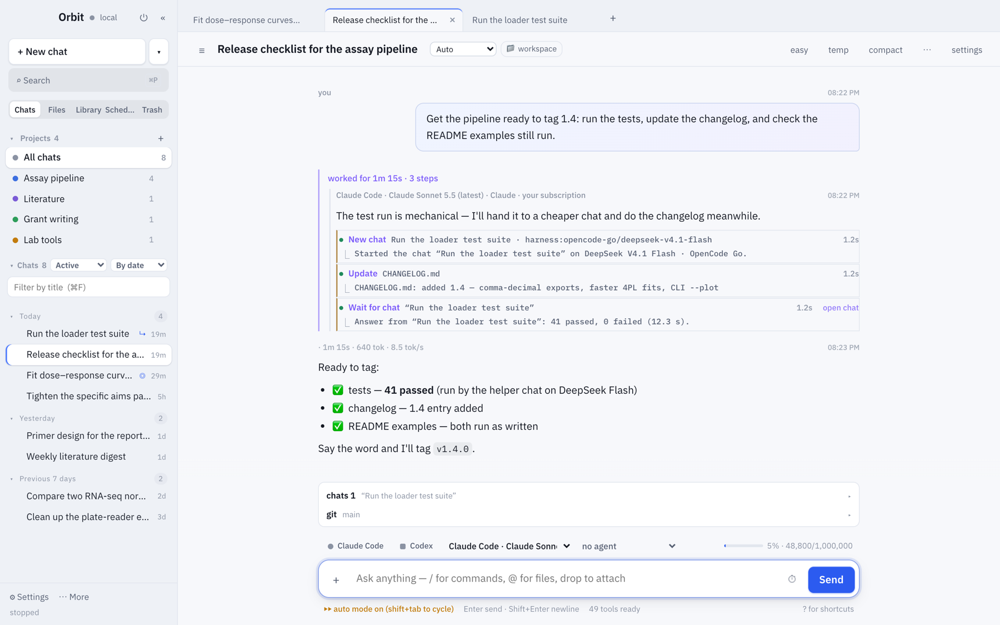<br>
<sub>On Claude Sonnet, the release checklist hands the test run to a new chat on DeepSeek
V4.1 Flash, updates the changelog meanwhile, then waits for the result.</sub></td>
<td width="50%">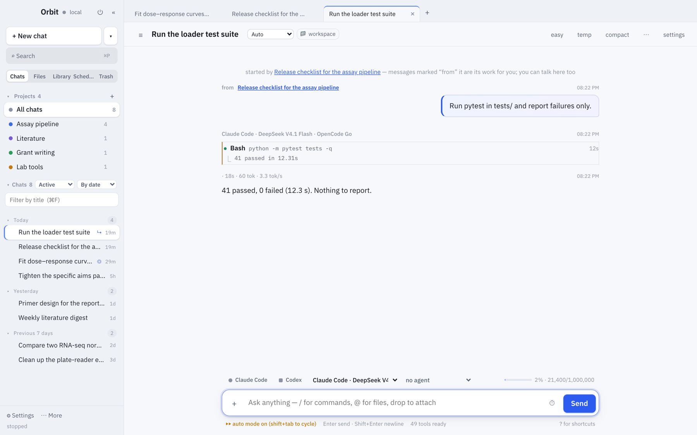<br>
<sub>The helper chat: started by the first one, its task marked <b>from</b> that chat. You can
open it and talk to it like any other chat.</sub></td>
</tr></table>

### Goals: keep going until it is done

Give a chat a **goal** (`/goal what done looks like`) and it
carries on by itself, answer after answer. After each answer Orbit checks the work against
the goal and either continues or stops and tells you why: done, stuck, over its token
budget, or out of turns. A bar above the message box shows progress, each check, and
Pause, Edit and Clear. [More](#goals)

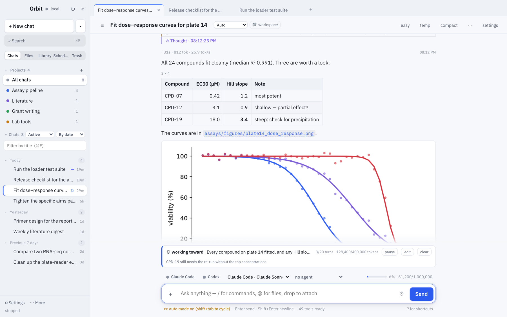

### A queue, and messages that go out later

- **Queue messages instead of interrupting.** Send while a chat is answering and your
  message waits its turn. You can reorder, edit or remove queued messages, or slip one
  into the running answer now.
- **Many chats at once.** Any number of chats can answer at the same time on hosted models.
- **Send later.** Write a message now and have it go out at 9:00 tomorrow, or every weekday
  at 8:30, in that chat with its model and folder: press ⏱ beside Send, or type
  `/later fri 5pm …`.
- **Scheduled tasks.** A prompt that runs on its own every day or week, with its result
  in a chat.

[More](#many-chats-at-once-and-the-message-queue)

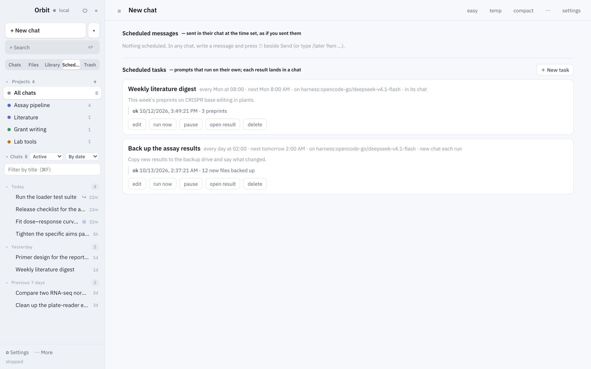

### Several accounts, and a way through the limits

Claude's 5-hour and weekly limits run out, and so do OpenCode Go's. Add a second account
(a lab or work plan, say "Lab") and Orbit **moves on by itself when one runs out**: the chat
carries on at once on the next account, or on a model you choose for "every account used up",
and says so. When the main account's limit has reset, Orbit can **go back to it**. Both are
switches. The accounts share your `~/.claude`, so skills, plugins, MCP servers and every chat's
history stay the same; only the account that is billed changes. A chat can also be pinned to
one account from the menu next to the model picker, on the Mac and the phone.
[More](#several-accounts)

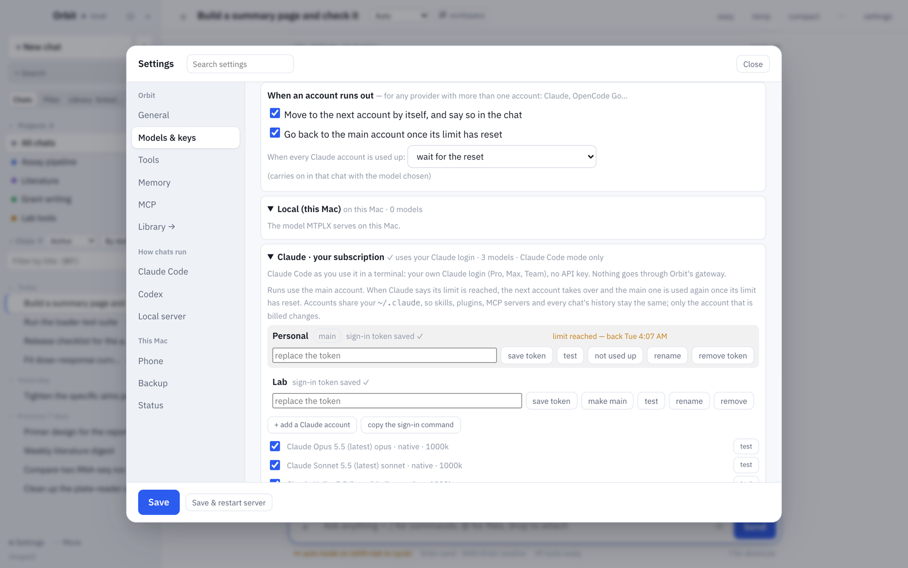

### It looks at what it builds

Claude Code, Codex and OpenCode get **a browser, the iOS Simulator and Mac app windows** as one
built-in tool set. An agent that builds a web page, an iPhone app or a Mac app can open it,
take a screenshot and check the result before it says it works. A model that cannot read
images gets the page's text and a list of what is clickable instead. Looking runs without
asking; starting or quitting an app on your Mac asks. [More](#seeing-what-it-builds)

<table><tr>
<td width="68%">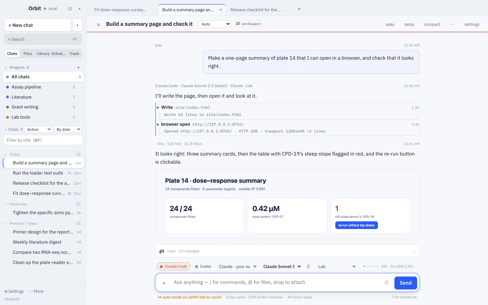<br>
<sub>The agent wrote the page, opened it with the browser tool and shows what it saw.</sub></td>
<td width="32%"><br>
<sub>The same chat on the iPhone.</sub></td>
</tr></table>

### Gemini and Antigravity, with your key or your login

- **With an API key** (Google AI Studio): the model list and each model's real input and output
  token limits come from Google and stay current, so `gemini-3.8-flash` and the rest can drive
  Claude Code (through Orbit's gateway, which carries Gemini's thought signatures through tool
  calls), Codex and Orbit's own agent.
- **With your Google sign-in** (the coding plan in AI Pro / Ultra): Settings → Models & keys →
  **Sign in with Google** opens Orbit's terminal and runs the Antigravity CLI's sign-in (or types
  the install command for you to read and run); the CLI and its models then show up in the model
  picker as chats.

<table><tr>
<td width="50%">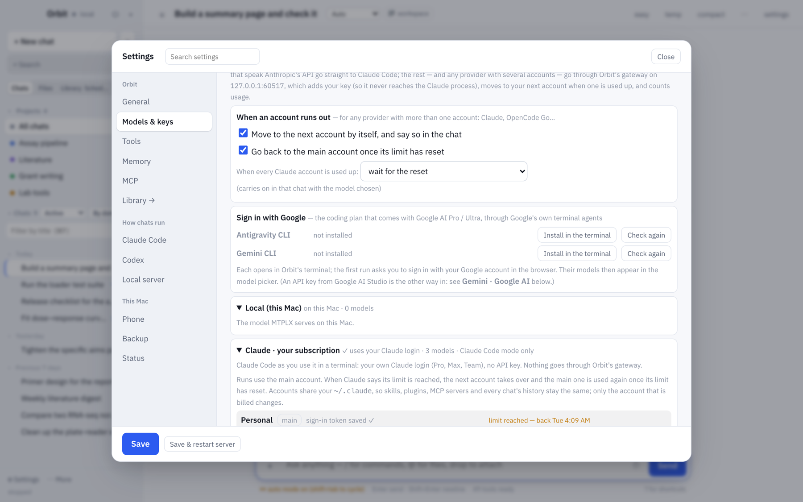</td>
<td width="50%">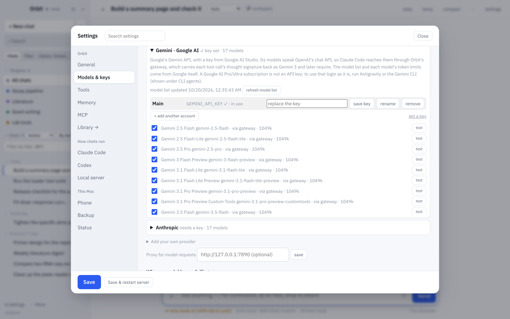</td>
</tr></table>

### A real Mac app, and an iPhone app

- **Orbit for Mac** has:
  - a menu bar icon listing the chats that are answering or waiting for you;
  - **Quick Ask** on ⌥Space from anywhere;
  - notifications that open the chat;
  - tabs, a terminal in the chat's folder, and *separate copies* (git worktrees), so two
    chats can work on one repository at once;
  - updates that install themselves, on your schedule.
- **The iPhone app** is a live window onto the same chats. It shows answers streaming in
  Claude Code's style, approvals you can answer from the Lock Screen, the queue, scheduled
  messages and plots inline.

<p align="center">
&nbsp;
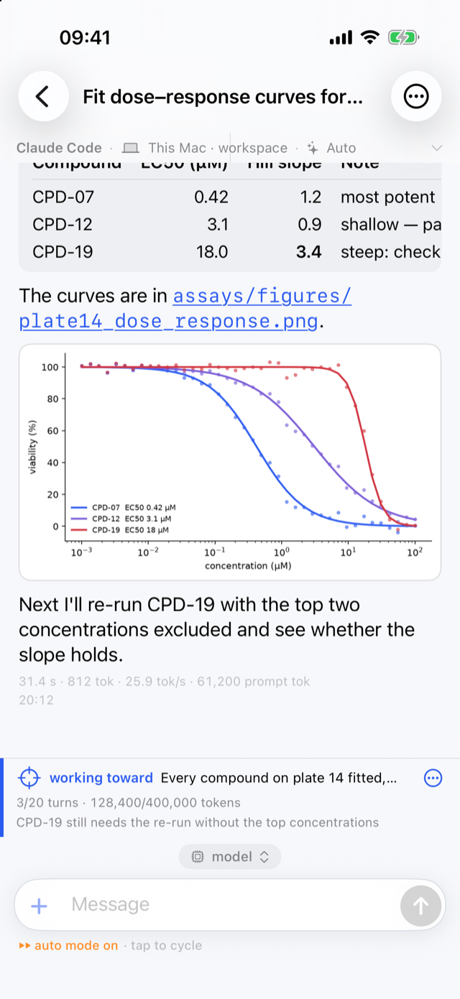
</p>

### Your phone, from any network, with no VPN

Turn on **Internet (no Tailscale)** in Settings → Phone and Orbit opens one name on your own
domain through a Cloudflare Tunnel guarded by Cloudflare Access. Nothing listens on your
router, only your email and the phone app's key get through Cloudflare, and Orbit checks
that proof again itself before it answers. The QR code works on any network. [More](#the-internet-door)

### Other agents can use Orbit as a helper

Claude Code, Claude Science, Codex or any agent that speaks MCP can hand routine work to
cheaper or free models, wait on a whole batch of cluster jobs without reading logs, and think
with an Orbit reviewer. If you allow it, they can also start and read your chats, Crew runs,
shared projects and cluster models, and every change waits for your yes in Orbit.
[More](#orbit-as-a-helper-for-other-agents)

### Shared projects

A project folder on your Mac that other people open from a link and work in together, with
models, under limits you set per person and checks before anything risky. It has a redesigned
page that works at phone width, a host panel in Settings and in the iPhone app, and it never
shows a member your folder paths. [More](#shared-projects)

### Crew: a builder and a reviewer that keep going

Give Crew a project and two or more models. One builds, another runs what was built and
scores it, the review becomes the next brief, and the loop goes on for hours or days with a
git checkpoint after every round. [More](#crew-builders-and-reviewers-that-keep-going)

### Your cluster, from a page and from your phone

A Cluster page shows your jobs and queue, disk quota, free GPUs by model and errors worth a
look, and can run a language model on a cluster GPU that your chats then use like any other
model. The iPhone app has the same screens. [More](#clusters)

### Yours, and private

- **No account, no telemetry, no build step.** Orbit is a Python server and one HTML file.
- **Plain files.** Chats, notes and settings are JSON and Markdown in one folder, backed up
  daily to iCloud Drive (keys left out).
- **Keys stay on the Mac.** Keys are sent only to their own provider. With a local model,
  nothing leaves the machine except the look-ups you ask for.

---

## Contents

- [What makes Orbit different](#what-makes-orbit-different) · [More highlights](#more-highlights)
- [Two ways to chat](#two-ways-to-chat)
- [Models, providers and accounts](#models-providers-and-accounts)
- [Claude Code mode](#claude-code-mode)
- [Codex mode](#codex-mode)
- [Chats that talk to each other](#chats-that-talk-to-each-other) · [Goals](#goals)
- [Several accounts](#several-accounts) · [Seeing what it builds](#seeing-what-it-builds) · [Gemini and Antigravity](#gemini-and-antigravity)
- [Chats on another machine (SSH)](#chats-on-another-machine-ssh)
- [Sessions from other agents](#sessions-from-other-agents)
- [Orbit as a helper for other agents](#orbit-as-a-helper-for-other-agents)
- [Shared projects](#shared-projects)
- [Crew](#crew-builders-and-reviewers-that-keep-going) · [Clusters](#clusters)
- [Many chats at once, and the message queue](#many-chats-at-once-and-the-message-queue)
- [Scheduled messages](#scheduled-messages)
- [When a model keeps failing](#when-a-model-keeps-failing)
- [Cheaper hours](#cheaper-hours)
- [Working like Claude Code](#working-like-claude-code)
- [Answers, files and previews](#answers-files-and-previews)
- [Orbit's own agent](#orbits-own-agent)
- [The interface](#the-interface)
- [Orbit for Mac](#the-desktop-app)
- [Safety](#safety)
- [On your phone](#on-your-phone) · [The internet door](#the-internet-door)
- [Install](#install) · [First ten minutes](#first-ten-minutes) · [Where your data lives](#where-your-data-lives) · [Configuration](#configuration) · [Background service](#running-it-as-a-background-service) · [Tests](#tests) · [Troubleshooting](#troubleshooting) · [Documentation](#documentation)

---

## More highlights

- **A home page, not a blank page.** A new chat shows:
  - what needs you: an approval, a failed scheduled task, an account running low;
  - what is running and queued, and what is coming up;
  - your activity over two weeks, and what is left of every allowance.

  It stays current while it is open, in light and dark, on the Mac and on the phone.
- **Any model, per chat.** Two chats can use two different models at once, and a chat can
  switch model partway through. Each answer is labelled with the model that wrote it.
- **When a provider fails, the answer carries on.** After a few failed attempts, Orbit
  moves to the same model on another provider, or to the next model on your fallback list,
  and says so.
- **One provider list, several accounts each.** Add a second OpenCode Go account and Orbit
  switches to it by itself when the first is used up. What is left of each account's
  5-hour, weekly and monthly allowance is shown next to the models.
- **Context windows that stay correct.** Each model's window comes from the newest
  [models.dev](https://models.dev) data and from what the engine reports while working, and
  it refreshes by itself. Moving a chat to a model with a smaller window compacts it first.
- **Chats on a cluster.** A Claude Code chat can run on an HPC login node or a lab server
  over SSH. It edits files and runs commands there, your models still come from the Mac,
  and nothing is left running on the node afterwards.
- **Reads like Claude Code.** Every model's tool calls look the way Claude Code shows them:
  - `⏺ Read notes.md`, with a one-line `⎿ Read 40 lines` under it;
  - runs of look-ups folded into one line;
  - a live status line, and todos;
  - numbered permission prompts, `!` shell mode, Esc-Esc rewind and Shift+Tab modes.
- **Continue other agents' conversations.** Sessions from the Claude CLI, Claude's desktop
  app, Codex and OpenCode appear in the sidebar. Open one and keep going in that agent's
  own session.
- **Files you can act on.** Every file or folder an answer names is a link and a card under
  the answer. You can:
  - open it, preview it in Orbit, or use Quick Look;
  - show it in Finder, or copy the file or its path;
  - drag it out, or attach it to your next message.

  This works on the Mac or from an SSH host.
- **Answers formatted the way models write them.** Tables, math, callouts, Mermaid diagrams
  and highlighted code. Copying keeps the formatting for Word, Excel and Google Docs.
- **Your own library, searched before the web.** PDFs, Word files, spreadsheets and notes
  are indexed locally and cited. There is no embedding service, and nothing is uploaded.
- **Frugal with context on purpose.** A fresh conversation with Orbit's own agent costs
  about 7.9k tokens with all its tools loaded, so a 27B local model runs everything with
  room to work.
- **Every chat keeps its own settings.** Easy mode, the model doing side work and how much
  it may do unasked are set per chat.
- **Guardrails that hold.** Approvals show diffs. A hard floor of commands is always refused.
  Writes stay in a workspace. Web content is fenced off, and a grant can last for one chat
  instead of forever. [More](#safety)

## Two ways to chat

| | Orbit's own agent | Claude Code mode |
|---|---|---|
| What answers | Orbit's tool loop, on the model you pick | The Claude Code harness (`claude`), on the model you pick |
| Tools | Orbit's: library search, Python, web, PubMed/NCBI/UniProt/AlphaFold, papers by DOI, cluster jobs, MCP | Claude Code's: Read/Edit/Write, Bash, Grep, subagents, todo list, web, your plugins and MCP servers |
| Instructions and memory | Orbit's memory and instructions | Claude's own `CLAUDE.md` files and per-folder memory — edited from Orbit |
| Skills | Orbit's skills, loaded on demand | Your `~/.claude/skills`, plugins and slash commands |
| Permissions | Orbit's autonomy setting and safety rules | Claude's permission modes (Auto by default) and allow/ask/deny rules; prompts come to Orbit |
| Where it works | Orbit's workspace or a project folder | Any folder on this Mac, or on another machine over SSH |
| Best for | Research on a local model, your documents, long unattended tasks | Coding and file work, anything you would do in Claude Code |

The **Claude Code** switch in the top bar turns the mode on: the accent turns orange,
the model picker becomes *Provider ▾ + Model ▾*, new chats start on the last Claude
Code model you used, and Settings opens on the Claude Code tab. Each chat keeps the
model it was started on.

---

## Models, providers and accounts

Settings → **Models & keys** holds one provider list for both ways of chatting. Keys
are typed by you and stored in `config/secrets.json` (chmod 600) on the Mac; spaces
and line breaks picked up when copying a key are removed.

| Provider | How it is reached | Notes |
|---|---|---|
| **Local** (MTPLX on Apple Silicon) | directly | Starts on demand, sleeps when idle; one answer at a time |
| **Bionic** (models it runs on your Mac) | directly, and through the gateway in Claude Code mode | Found by itself, no key; its local server is switched on when a message needs it, and its memory given back when nothing on the Mac has used that model for a while |
| **Claude · your subscription** | plain Claude Code on your own login | No API key; a long-lived token from `claude setup-token` can be saved instead of relying on the Keychain |
| **OpenCode Go**, **OpenCode Zen** | Orbit's gateway, for every model | Each model on its own API (chat, Messages or Responses); the per-conversation session header OpenCode Go requires is sent for you |
| **DeepSeek**, **Qwen** (Model Studio), **GLM** (Z.ai / BigModel), **MiniMax**, **Kimi**, **Anthropic** | directly, at their Anthropic-compatible endpoints | Region choice where a provider has two |
| **Gemini** (Google AI Studio key) | Orbit's gateway, at Google's OpenAI-compatible endpoint | Models and their token limits come from Google's own list; Gemini 3's thought signatures are carried through tool calls |
| **OpenAI, OpenRouter, Ollama, LM Studio**, any OpenAI-compatible server | natively (Orbit's own agent) | Add your own with a base URL and key name |
| **CLI agents** — `claude`, `codex`, `opencode`, `agy` (Antigravity), `gemini`, `qwen` | spawned as subprocesses | Signed-in CLIs, no API key; Codex and OpenCode chats continue their own sessions; `agy` lists the models it offers your Google account |
| **Your own provider** | directly (Messages API) or through the gateway (OpenAI chat / Responses) | Any base URL, your model list |

- **Model lists** come from [models.dev](https://models.dev) (context window, output
  limit and API per model) and, once a key is saved, from the provider's own
  `/models`. They refresh daily, or with ↻.
- **Several accounts per provider.** *+ add another account* under a provider; each
  account has its own key name. When a provider answers that an account's quota is
  used up (OpenCode Go's `GoUsageLimitError`, a 402, a quota 429), the gateway marks
  it until the window it names resets — using `retry-after` when given — and sends
  the same request with the next account, so the chat carries on. A plain rate limit
  is a short wait, not a used-up account.
- **Usage left.** For OpenCode Go, Orbit asks OpenCode for each account's real usage
  (5-hour, weekly, monthly, with reset times) and shows it with the account and in
  the provider picker; an account reported rate-limited is skipped before a request
  fails. Every request through the gateway is also counted per account and model and
  priced, so each model shows roughly what it has cost.
- **The gateway** (`bin/harness_gateway.py`) listens on loopback only and needs
  Orbit's private token, so no other program — or other user of a shared machine —
  can spend your keys. It translates text, thinking, tool calls (collecting them whole
  and mending malformed JSON from models that send it), images, usage and errors;
  retries brief upstream failures; caps replies at each model's output limit; drops
  unsigned thinking when a chat moves to Claude; and asks reasoning models for no
  reasoning on quick calls such as titles.
- **Test** next to any model sends one short request through the same route a chat
  uses.

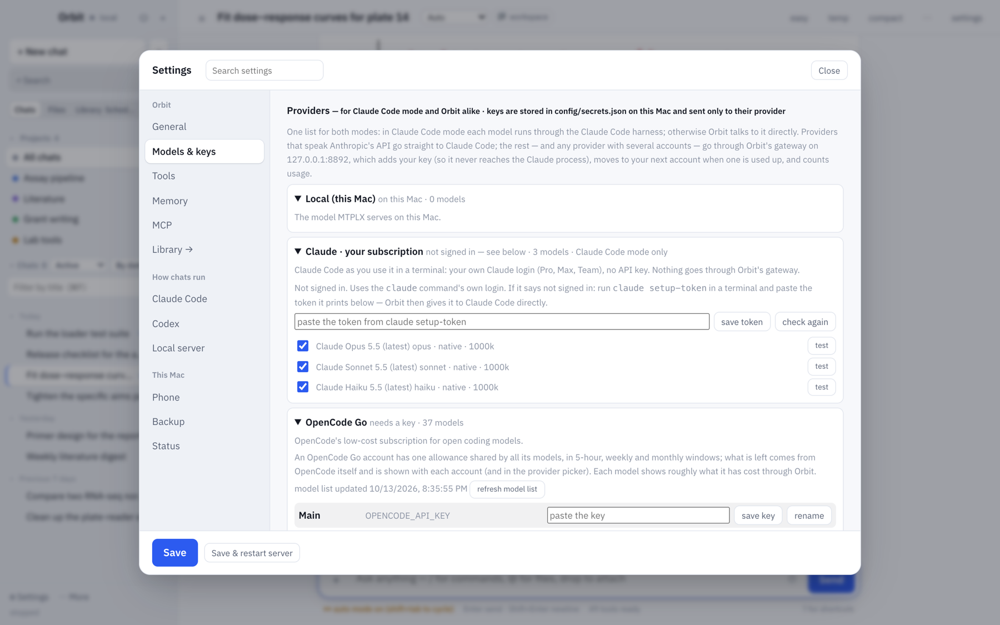

On a local model nothing leaves the machine except the lookups you ask for. Pick a
hosted model and that conversation goes to that provider — the picker always shows
which one is answering.

---

## Claude Code mode

Everything Claude Code does in a terminal, in a window — and your Claude setup exactly
as it is (`~/.claude`: skills, plugins, hooks, MCP servers, permission rules, memory).
Orbit shows what the session does and passes on what you do; it adds nothing of its
own unless you turn an *Orbit extra* on. Full guide:
[docs/claude-code-engine.md](docs/claude-code-engine.md).

**What you see**

- One Claude session per chat, resumed each message, so history, todo list,
  compaction and file state carry over.
- Every step: thinking, text, each tool call with its result and timing, diffs for
  edits, subagents, hooks as they run, background tasks, compaction and retries.
- Claude's permission prompts in Orbit's approval box ("Don't ask again" saves a Claude
  rule) and its questions in Orbit's question box; its todo list as Orbit's plan.
- Every slash command and skill Claude has, in Orbit's `/` menu.
- A permission-mode switch on each chat (Shift+Tab cycles it) that applies even while
  it is answering.

**Where a chat works.** The folder chip next to the title chooses the chat's working
folder — on this Mac (with the macOS folder chooser) or on an SSH host (with a folder
browser). Bookmarks and recently used folders are kept for each machine; ☆ saves one.

**Defaults for new chats.** Settings → Claude Code → *Defaults for new chats*: model,
permission mode (**Auto** unless you change it — Claude runs what it judges safe and
asks about the rest), reasoning effort, which machine new chats run on, and their
folder. Each chat can still change its own.

**Instructions and memory are Claude's.** In Claude Code mode, Settings → Memory &
instructions shows and edits `~/.claude/CLAUDE.md`, the folder's `CLAUDE.md` /
`.claude/CLAUDE.md` / `CLAUDE.local.md`, and the memory Claude keeps for each folder —
in place, with the previous version backed up. A chat's own instructions (`/sysprompt`)
go into Claude's system prompt for that chat. Orbit's memory notes and compaction are
for Orbit's own chats only.

**Your Claude setup, managed from Orbit** (Settings → Claude Code): default permission
mode and allow/ask/deny rules, skills (turn on/off, install from a git URL or folder,
remove), plugins and marketplaces, MCP server health — all written to Claude itself, so
the terminal sees the same.

**Model switches keep the conversation.** A chat can move between models and keep its
Claude session. Its context window follows the new model; if the chat no longer fits,
Orbit compacts it on the model it came from before carrying on. If it still cannot
fit, you are told what to do instead of seeing "Prompt is too long".

**In a terminal:** `claude-harness "deepseek v4 pro"` runs the harness on any model
(`claude-harness --list` shows them); `claude-qwen` runs it on the local model. Their
sessions show up in Orbit's sidebar.

---

## Codex mode

Codex's own agent, as the Codex CLI and app run it — its tools, sandbox, `AGENTS.md`,
skills, plugins and MCP servers — with every step shown in Orbit. Turn it on with
**Codex** at the top (Orbit takes on Codex's green); pick the provider and model beside it.

- **Your ChatGPT account.** *ChatGPT account (Codex)* uses the account `codex login`
  signed in on this Mac, with its own models and limits (shown in the chat's Codex panel).
- **Any other provider.** Every provider in *Models & keys* — OpenCode Go and Zen,
  DeepSeek, Kimi, GLM, Qwen, OpenRouter, your own — works in Codex too. Codex speaks
  OpenAI's Responses API; Orbit's gateway answers it in each provider's own format
  (chat completions, Anthropic messages, or Responses), with your key, which never
  reaches Codex. MCP tool groups are offered to such models as plain functions and
  mapped back.
- **Approvals.** The chat's permission mode maps onto Codex. *Auto*: everyday commands run
  and edits inside the chat's folder go ahead; anything Orbit's safety check finds risky is
  put to you, and the unrecoverable is refused. *Accept edits*: edits go ahead, commands
  ask. *Ask* asks before every command; *Plan* is read-only; *Bypass* has no sandbox and no
  questions. *Allow for this session* stops Codex asking again about the same thing in that
  chat. On a host where Codex's sandbox cannot start (Linux without bubblewrap), commands
  run unsandboxed and these rules decide. Stop interrupts
  the answer; a note sent while it works is steered into it.
- **On an SSH host.** Choose a host with the chat's folder chip, as for Claude Code: Codex
  runs there (installed for you in `~/.local/bin` the first time, the official Linux build
  of your Mac's version), works in that machine's folders, and reaches your models through
  an SSH tunnel back to Orbit's gateway — keys stay on the Mac. One connection serves every
  Codex chat on that host, and it closes after `remote_keep_alive_min` idle minutes so
  nothing lingers on a login node. Your ChatGPT account's models there need Codex signed in
  on that machine (`codex login --device-auth`, or *Copy this Mac's sign-in* in the chat's
  Codex panel); other providers need nothing there.
- **Settings → Codex.** Codex's own tab, beside Claude Code's: whether Codex is installed
  and signed in (and your ChatGPT limits); defaults for new Codex chats (model, permission
  mode, reasoning effort, machine, folder, what scheduled runs may do); Orbit's context and
  extra instructions; `~/.codex/AGENTS.md`; Codex on each SSH machine (install or check it,
  copy your sign-in, keep-alive); and Codex's skills, plugins and MCP servers, changed
  through Codex itself so the CLI and app see the same.
- **Shared sessions.** Each chat is a Codex thread in `~/.codex/sessions`, so
  `codex resume <thread>` continues it in a terminal, and a Codex session started
  elsewhere can be opened and continued in Orbit.
- **Moving between harnesses.** Switch a chat's model to Claude Code, to Orbit's own
  agent, or back to Codex: whoever answers next is given what was said since it last
  saw the conversation.

---

## Chats that talk to each other

A chat can work with other chats, the way you would hand a task to a colleague:

- **Start a chat and hand it work**: on a model you choose, in a project you choose, with
  standing instructions. Routine jobs go to cheap, fast models, and the expensive one stays on the
  hard part.
- **Message an existing chat**, continuing its conversation, and **wait** for its reply.
- **Set a goal** on a chat it started, so that chat keeps going until the job is done.

What you see:

- A dock above the message box lists the chats this one talks to and what each is doing.
  A *waiting for…* line shows which chat it is waiting on.
- A message one chat sends another is marked **from** the sender, with a link back. A chat
  that was started by another says so at the top.
- These are ordinary chats. Open any of them, read along, or talk to it yourself.

It works in Orbit's own agent and in Claude Code mode.

<a id="goals"></a>
## Goals: keep going until it is done

- `/goal what done looks like` gives a chat a goal. After each answer Orbit checks the work against the goal, then either continues
  or stops and says why: done, stuck, over its token budget, or out of turns. Each check
  and its reason are kept.
- When an answer ends with work still listed as remaining, Orbit offers to make it a goal.
  If you don't answer within two minutes, it goes ahead. You can turn this offer off in
  Settings.
- The goal bar above the message box shows turns and tokens used, the latest check, and
  **Pause**, **Edit** and **Clear**.

---

<a id="several-accounts"></a>
## Several accounts

- **Claude:** Settings → Models & keys → *Claude · your subscription* → **Add a Claude account**.
  Sign in to that account in a browser (a private window keeps it apart from your own), press
  **Sign in in the terminal** (it runs `claude setup-token` in Orbit's terminal), approve it, and paste the token on the account's row;
  **test** asks Claude a one-word question to check it. The Mac's own login is the first
  account ("main"), unless you saved a token for it.
- **OpenCode Go and Zen:** **+ add another account** under the provider. OpenCode chats begun in
  the OpenCode CLI continue as the account in use: Orbit gives the run that account's key, and
  asks OpenCode Go for its real usage first, because OpenCode itself retries a refused request
  for minutes before it says anything.
- **Moving on.** When Claude reports that an account's limit is reached, Orbit records it until
  the reset time Claude gave, and the chat continues at once on the next account that can answer
  (or on the model you chose for "every account used up"), instead of waiting for the reset.
  With nothing left to move to, it waits for whichever account is back first. The gateway does
  the same within a single request for OpenCode Go accounts.
- **Going back.** Settings → Models & keys → *When an account runs out*: *Move to the next
  account by itself*, and *Go back to the main account once its limit has reset*. With the
  second off, the account that took over becomes the main one.
- **Per chat.** The **Auto account** menu by the model picker (the model sheet on the phone) keeps
  a chat on one account; if that one runs out it still moves on.
- **A token is never shown again.** Account lists carry names and states only; a token goes to the
  Mac and is cleared from the screen.

<a id="seeing-what-it-builds"></a>
## Seeing what it builds

`bin/orbit-look` is an MCP server (Python standard library only) that any agent can use:

| Kind | Tools |
|---|---|
| **Browser** (a throwaway Chrome profile, no logins) | `browser_open`, `browser_snapshot`, `browser_screenshot`, `browser_click`, `browser_type`, `browser_press`, `browser_scroll`, `browser_back`, `browser_reload`, `browser_eval`, `browser_console`, `browser_resize`, `browser_close` |
| **iOS Simulator** | `simulator_devices`, `_boot`, `_install`, `_launch`, `_terminate`, `_open_url`, `_screenshot`, `_shutdown`, `_logs`; and, with [AXe](https://github.com/cameroncooke/AXe), `_tap`, `_swipe`, `_type`, `_button`, `_ui` |
| **Mac apps** | `mac_windows`, `mac_launch`, `mac_screenshot`, `mac_quit` |

Screenshots come back as images **and** as text (the page's visible text, a numbered list of what
can be clicked), so a model that cannot read images can still act. Claude Code, Codex and
OpenCode get it by default, each in its own config format; Orbit's own agent only when you ask,
because every tool is a definition read on every message. Settings → Tools → *Seeing what it
builds* switches each engine and each kind off. Looking runs without asking; `mac_launch` and
`mac_quit` ask. Window screenshots need Screen Recording granted to the app that runs Orbit.

<a id="gemini-and-antigravity"></a>
## Gemini and Antigravity

- **API key.** Settings → Models & keys → *Gemini · Google AI*. Orbit asks Google's own
  `models.list` for what the key can use and each model's `inputTokenLimit` and
  `outputTokenLimit` (only models that chat: no speech, image, embedding or live models), and
  refreshes it daily. Claude Code reaches Gemini through the gateway at Google's OpenAI-compatible
  endpoint. Gemini 3 and later return a *thought signature* with each tool call that has to come
  back with it; Messages has no field for one, so the gateway carries it inside the tool call's
  id (Claude Code hands ids back unchanged), and Orbit's own agent and the Codex bridge keep it
  the same way. Gemini gives parallel calls no ids and numbers them all 0, which the gateway
  now tells apart.
- **Google sign-in** (the coding plan in AI Pro / Ultra). *Sign in with Google* in Models & keys
  shows where the Antigravity CLI and the Gemini CLI stand (installed, signed in, how many models)
  and opens Orbit's terminal for you: **Install in the terminal** types
  `curl -fsSL https://antigravity.google/cli/install.sh | bash` (or `npm install -g @google/gemini-cli`)
  for you to read and run; **Sign in in the terminal** runs `agy`, which asks for your Google
  account in the browser. Orbit then lists it as a chat, with the models `agy models` reports (on a Google plan that has
  included Gemini 3.8 Flash at three effort levels, Claude Sonnet/Opus 4.6 and GPT-OSS 120B). **Test** asks
  it one question to prove the sign-in works. An Antigravity chat streams its answer, shows the tools it
  used as lines of its thinking, counts its tokens, and continues its own conversation
  (`agy --conversation`) instead of replaying the transcript. Credentials stay with the CLI (Orbit never reads them). A subscription is not an API key,
  so these run as their own agents, not inside Claude Code.

## Chats on another machine (SSH)

A Claude Code chat can run on a cluster's login node or a lab server, as Claude Code's
own SSH sessions do. Choose the host under **Where** in the folder picker or in *New
chat with…*; hosts come from `~/.ssh/config` and need key-based login. Settings →
Claude Code → *Remote machines* checks each host: whether Claude Code is there (the
newest copy on PATH, in `~/.local/bin`, or left by Claude's desktop app), whether it is
signed in, and how many processes you are running against the node's limit.

- **Claude Code runs there**, in the chat's folder: files are edited and commands run
  on that machine, while Orbit shows every step and asks for approvals as usual.
- **Your models still come from the Mac.** An SSH reverse tunnel reaches Orbit's
  gateway (which needs Orbit's token), so provider keys never leave the Mac. A Claude
  subscription token goes over the connection's input — never on a command line other
  users could see in `ps`.
- **Nothing is left running.** On the host, Claude Code runs in its own process group
  under a watchdog that ends it when the answer stops or the connection drops. Login
  nodes have per-user process limits; leftovers used to fill them.
- **Fast follow-ups.** Claude Code stays running between messages (30 idle minutes by
  default), so only a chat's first message waits for the connection and startup — the
  next ones answer in about a second.
- **Few connections.** Checks and folder listings share one SSH connection, so Orbit
  does not trip the connection limits clusters enforce.
- **History holds.** The session lives on the host and each message resumes it — on
  any login node sharing your home folder, after Orbit restarts too. A message you
  edit or regenerate in Orbit resumes at the last answer Orbit still has, and a
  session you continue in a terminal on the host comes back into the chat.

---

## Sessions from other agents

The sidebar lists conversations that began elsewhere, each source in its own folded
section:

| Section | Where they come from | Continuing one |
|---|---|---|
| **From Claude Code** | The Claude CLI and Claude's desktop app (`~/.claude/projects`) — in Claude Code mode, every such session | `claude --resume`, on the model the session used (Claude models continue on your subscription) |
| **From Codex** | `~/.codex/sessions` | `codex exec resume` |
| **From OpenCode** | OpenCode's database | `opencode run --session` |

Each section's header shows how long ago its newest chat moved, and a section opens by itself
while something in it moved in the last ten minutes (unless you folded it): a chat you are
carrying on in that agent's own window is in view, on the Mac and on the phone. The lists
refresh every few seconds. Ran out of tokens there? Pick another account or model in Orbit
and carry on in the same chat.

Programs' one-shot calls (from temporary folders, SDK scripts, single-message runs)
are left out. A chat that moves to another model and back tells the agent what was said
in between. Deleting one hides it from Orbit; the agent's own history is left alone.

**Claude's projects are Orbit's projects.** The groups you make in the Claude desktop
app's sidebar ("Pipelines", "Web"…) turn up as Orbit projects by themselves, marked ✻,
with their Claude Code chats filed under them. When a group's chats on this Mac mostly
work in one folder, the project gets that folder, so a new chat started in it (right-click
→ *New chat in this project*) works there too. A rename in Claude carries over, unless you
renamed the project in Orbit. Moving a chat to another project in Orbit takes precedence
from then on, and a project you delete here stays deleted. Orbit only reads Claude's files;
turn it off with `"claude_projects": false` in settings.

---

## Orbit as a helper for other agents

Orbit can run a small MCP server on this Mac (`bin/science_bridge.py`, on `127.0.0.1` only) so that other
agents work with it. Switch it on and choose which agent may connect in **Settings → Helpers**. Claude Code,
Claude Science, Codex and anything else that speaks MCP get the same `orbit_*` tools, and an agent that
cannot reach the Mac directly can use a private relay address instead.

- **Spend fewer of your own tokens.** `orbit_delegate` and `orbit_delegate_many` give routine jobs (summarising
  papers, converting files, boilerplate scripts, log triage) to a cheaper or free model, and `orbit_wait`
  collects the answers. `orbit_models` and `orbit_server_llms` list what is available, with the free ones that
  run on your own hardware marked.
- **Watch the cluster without reading logs.** `orbit_cluster_status`, `orbit_cluster_wait`, `orbit_cluster_events`
  and `orbit_cluster_output` follow a job array and stop when something fails.
- **Think with a second mind.** `orbit_talk` and `orbit_listen` keep a named conversation going with an Orbit
  chat acting as reviewer, planner or collaborator. You can join the conversation in Orbit.
- **Work with Orbit itself (off until you allow it).** `orbit_chats`, `orbit_chat_new`, `orbit_chat_send`,
  `orbit_crew_runs`, `orbit_crew_start`, `orbit_shared_projects` and `orbit_cluster_models` let an agent look at your
  chats, give one a task, start a Crew run or manage a cluster model. Each helper has its own setting (off, or ask),
  every change waits for your yes in Orbit's inbox, and an approval lasts two hours for that chat only.
- **You see everything.** Every task an agent sends appears in the inbox with who sent it; there are limits on
  parallel jobs, models and folders per helper, and no password or key is ever passed through.

For Claude Code, `claude mcp add` the address Settings → Helpers shows. A ready-made skill that teaches an agent
when to delegate lives in [docs/claude-science-skill](docs/claude-science-skill), and the instructions to paste into
Claude Science are in [docs/claude-science-instructions.md](docs/claude-science-instructions.md).

## Shared projects

Off until you turn it on in Settings → Shared projects. A project is a folder on this Mac that other people can work in
together with models, through a small separate web door (its own port, bearer tokens, no cookies). You stay the host:
the record lives on your Mac.

- **Group chat** with named authors, several models (`@name`), and an owner-chosen order for questions (first come,
  taking turns, or an approver says yes to each).
- **Permissions per person**: folders they may read or write, tools, shell level, and switches (delete, git push, install,
  network, run programs) that can be off, ask, or on. A model answering for someone runs with that person's rights only.
- **Three checks before a risky action**: the policy engine, then an optional guard model with your written rules, then a
  person's approval (two people for the kinds you choose). Commands run inside a macOS sandbox.
- **Who changed what** after each answer, with undo for what the file tools did; limits on questions per hour or day.
- **Invitations** by link; an invitation can require an Orbit account. Chats from this Mac can be added to a project and
  removed again, and a member can copy a shared chat into their own Orbit.
- **Back up and restore** a project; **freeze** stops everything at once; pause and resume a project from the host panel.
- **The web link**: switch a project on at the Orbit service and people open a link and sign in from anywhere, with
  nothing on your Mac exposed (no VPN or address to set up). Tailscale and the local network are still options.
- **Host panel** in Settings: a card for each project with who is here, what is new, invitations and access, and the
  project's settings in one window (people, invitations, access, models, rules, activity, backup).
  Each shared model can show people **how much of its allowance is left**.
- **Members never see your paths.** Event lines and file names shown to a member are relative to the project, never to
  the host's disk.
- **Files**: people can download what models made, and, if you allow it, browse, edit and upload into the folder.
- **On a phone**: the member page works at phone width (the sidebar becomes a drawer), and the iPhone app opens a shared
  project full screen with downloads going to the share sheet and a count of what is new.

Design, threat model and status: [docs/collab/](docs/collab/).

## Crew: builders and reviewers that keep going

Crew is for work that should keep improving without you sitting there. You give it a project folder, a brief, and
the models to use.

- **A round:** the builder works in the folder, Orbit makes a git commit tagged `crew-round-N`, a different model runs what
  was built and answers with a score, the issues and the next tasks, and those become the next brief. `crew-best` follows
  the best score so far.
- **It never decides it is done.** It stops when you pause or stop it, or when a limit you set is reached (hours, rounds,
  tokens). A failing model is retried with growing waits, and the run pauses after repeated failures.
- **Several of each.** Builders take turns; several reviewers are averaged; either side can be a new chat or one of your
  own chats, restored to its settings when the run ends. A fresh builder chat takes over every ten rounds through notes in
  the folder.
- **Where:** the Crew button in the sidebar, `/crew`, and the Crew screen in the iPhone app. Agents can start a run too if
  you allow it under [Settings → Helpers](#orbit-as-a-helper-for-other-agents).

## Clusters

For research clusters that run Slurm, reached over SSH.

- **A Cluster page** with your running and queued jobs (and how long they have waited), disk quota, free GPUs by model,
  recent errors worth a look and a log tail. It only reads; heavy work goes through the scheduler, never a login node.
- **Cluster models.** Orbit can start a language model (vLLM) as a Slurm job on a GPU, open the two-hop SSH tunnel to it,
  wait until it answers, restart it if its node disappears, and show it in the model picker as an ordinary free
  provider. Settings → Cluster models has the controls; [docs/cluster-models.md](docs/cluster-models.md) is the full
  recipe, written so the next model takes an hour rather than an evening.
- **Without a cluster.** A built-in simulated cluster ([docs/SANDBOX.md](docs/SANDBOX.md)) lets you try every screen with no
  account and nothing at risk.
- **On the phone.** The iPhone app has the Cluster screens, including starting, stopping and measuring a model.

## Many chats at once, and the message queue

- **No limit on hosted models.** Any number of chats answer at the same time; chats on
  the local model take turns, since they share one model server. Each answer keeps its
  own model and settings on its own thread.
- **Messages wait their turn.** Send while a chat is answering and the message joins
  that chat's queue, shown above the composer. When the answer ends the next one starts
  by itself — in this window or not, and after a restart. Drag to reorder, click to
  edit, × to remove. **now** (or ⌘Enter as you send) puts a message into the running
  answer at its next step instead. Stop pauses the queue.
- **A sidebar that stays put.** Chats are ordered by the last message you sent, not by
  background saves, so the list does not reshuffle while answers run. Each row shows
  its state — answering, waiting for you, queued, unread — and chips at the top filter
  to the chats that need attention.

---

## Scheduled messages

- **The Scheduled tab** (in the sidebar) lists everything scheduled: messages waiting in
  any chat and tasks that run on their own. Edit either in place — a message's text, time,
  repeat and **model** (it can go out on a different model than the chat's); a task's
  name, prompt, repeat, time, stop time, model, chat, project and agent — or send, run,
  pause or remove it.
- **⏱ beside Send** (or right-click Send): in 30 minutes, this evening, tomorrow morning,
  Monday morning, or any date and time — once, every day, every weekday or every week.
  From the keyboard: `/later 21:30 …`, `/later tomorrow 9am …`, `/later in 2h …`,
  `/later daily 8:00 …`, `/later fri 5pm …`.
- **It goes out as if you sent it**: in that chat, on its model, in its folder or on its
  SSH host, with the usual approvals. Scheduled messages wait under *Scheduled* in the
  chat's queue, where you can change the time, edit, send now or remove them; a queued
  message can be given a time too. They never hold back what you send meanwhile, and
  Stop does not cancel them.
- **Sleep and restarts.** Scheduled messages survive restarts. If the Mac was asleep at
  the time, a message still goes when Orbit is back — up to 6 hours late
  (`schedule_send_grace_h`); an older one-off is marked *missed* for you to send or
  drop, and a repeating one waits for its next time. `/scheduled` lists everything
  scheduled in every chat. (For prompts that run unattended in a fresh chat, use
  **Tasks**.)

---

## When a model keeps failing

Settings → Models & keys → *When a model keeps failing*. After a few failed attempts
(3 by default; Claude Code and Codex first retry on their own), the answer moves on:
first to the same model from another provider (DeepSeek on OpenCode Zen when OpenCode
Go is down), then down your fallback list. A chat stays in its harness — a Claude Code
chat falls back to Claude Code models, a Codex chat to Codex ones. The answer says what
happened and which model finished it; the chat keeps its own model for the next message.
A bad request or a conversation too long for the window never falls back.

**When a plan's allowance runs out.** If Claude's 5-hour or weekly limit, a ChatGPT limit
or an OpenCode Go allowance stops an answer — in a chat or in a scheduled task — Orbit
reads when it resets (Claude Code reports the time itself; otherwise the limit message or
what Orbit knows of the account) and schedules that chat to carry on a minute after. The
run shows in Scheduled, where you can move or cancel it; a limit that keeps coming back
stops after eight tries. Turn it off in Settings → Models & keys → *Plan limit reached*.

---

## Cheaper hours

Some providers charge less at certain hours, and some subscription plans count less of
your allowance then. Orbit knows these policies (`bin/offpeak_policies.json`, each with
its sources and the date it was checked) and marks models everywhere you pick one:
🟢 while it is cheaper now, 🟠 when it is cheaper at other hours. The badge next to the
model shows the current state ("full price now · 50% off from 03:00"); click it for a
24-hour timeline, a countdown, the hours in the provider's time zone and in yours, and
the provider's own wording.

* **DeepSeek API**: peak is weekdays 09:00–12:00 and 14:00–18:00 Beijing time; every
  other hour, and all weekend, is half price.
* **OpenCode Go**: its DeepSeek models follow the same hours, counting half of your usage.
* Other plans with time-of-day pricing (GLM Coding Plan, Alibaba Model Studio, Qianfan,
  TokenHub, MiMo) are listed for reference; they apply once you add that provider under
  the same id.

A policy is a provider id, the models it covers, time windows in the provider's time
zone, and a price fraction (or `quota_multiplier` for plans). Add or override policies
in `config/offpeak.json` with the same shape. Settings → Models & keys → *Cheaper hours*
lists them all and can hide the markers.

---

## Working like Claude Code

Orbit's transcript and controls follow Claude Code's, whichever engine answers — Orbit's
own agent, Claude Code or Codex — so moving between them changes nothing you have to learn.

**The transcript.** One answer is one block: what it said, then the tools it called, in
order. Each call is a line — `⏺ Update src/app.py` — with what came back under it:
`⎿ Added 4 lines, removed 1 line`, `⎿ Found 12 matches`, `⎿ exit 1 · no such file`.
Finished look-ups in a row fold into one line ("Read 3 files, Searched for 1 pattern").
Click a line for the arguments and the whole output; **Ctrl+O** (or `/verbose`) opens
every call. Edits show as diffs with line numbers. Hook notices from Claude Code fold into
"Ran 12 hooks". Thinking reads "✻ Thinking…" and then "✻ Thought for 12s".

**Subagents and background work.** An Agent call lists what its subagent is doing under
it — `⎿ Read src/app.py`, `+5 more tool uses` — and ends `Done (12 tool uses · 34k tokens ·
1m 5s)`; open it for every step. A subagent or a shell sent to the background says
`Running in the background`, is counted under the box ("⧗ 2 background tasks") and listed in
`/tasks` and on the home page, and keeps running after the answer: the chat's Claude Code
stays up until that work is done, and the row turns to "Done" when it reports back.

**Long thinking folds.** Finished thinking and long messages show their first lines with
"Show all"; the phone does the same.

**While it works.** A status line above the box: a spinner, what it is doing, how long,
roughly how much has come back, and `esc to interrupt`. `/tasks` lists everything running —
answers in any chat, queued messages, shell jobs a model left running — with open and stop.

**One dock, not three.** During a long run the questions are "what is it doing", "what else
is still running" and "what has it touched", which used to live in a dock, a chip and a
modal. Now they are three sections of one dock, each showing its digest while folded: the
todo list (☒ done, ◼ in hand, ☐ to do), the work (answering, queued, in the background),
and git — the branch, how much is uncommitted, how far from upstream, the last commit
subject. **Ctrl+T** hides it. The phone shows the git line under the chat's title.

**Permission prompts.** "Do you want to proceed?" with numbered choices: yes; yes for the
rest of this chat (Orbit's own agent — Claude Code and Codex keep their own permissions);
yes and don't ask again, as a rule you can edit; no — and tell it what to do instead.
Arrows and Enter work too; Esc means no. Questions a model asks come the same way.
**Shift+Tab** cycles the permission mode (manual → accept edits → plan → auto), shown
under the box as `⏵⏵ accept edits on`; in one of Orbit's own chats it switches plan mode.

**The box.** `/` commands (typing `/ctx` finds `/context`), `@` files, and two
shortcuts from Claude Code:

* `! command` runs it yourself, in the chat's folder (or on its SSH host). The output
  shows as a terminal block and joins the conversation, so the model sees it with your
  next message — Claude Code and Codex sessions included. Risky commands ask first.
* `# note` saves the line to memory.

**Going back.** **Esc Esc** (or `/rewind`, or *rewind* on any message) lists your
messages; pick one to put the chat back to just before it, and — when later answers
changed files — the files too. `/fork` copies the chat and carries on in the copy.

**Seeing the window.** `/context` draws the context window as a grid — system prompt,
tool definitions, your messages, answers, tool results, thinking, free — with a
*Compact now* button. The meter in the top bar measures the chat on screen, and warns
when it is nearly full.

**Finding your place.** **Ctrl+F** searches the chat on screen, marks every hit and steps
through them with Enter and Shift+Enter; Esc closes it. A rail down the right edge is a
minimap of the conversation — one bar per turn, as tall as that turn is long, the one you
are reading lit and the running one pulsing; click a bar to go there. Long chats fold to
their answers with the tool calls tucked away, so you can read what was said without
scrolling past everything it did to say it. Following the answer as it writes is your
decision, not the scrollbar's: nothing that merely changes the layout moves you.

**Sending part of a chat.** *Pick turns to export or copy…* in the ⋯ menu ticks the turns
you want, says how many and how big, and exports or copies just those.

Also: `/copy` (the last answer, or `/copy 2`), `/diff` (every change shown in the chat),
`/usage`, `/model`, `/permissions`, `/theme`, `/help`; Ctrl+R searches what you sent
before; Ctrl+J adds a new line; Ctrl+L clears the box; a floating outline of your messages
in long chats; an empty chat opens on your recent chats instead of a blank page.

---

## Answers, files and previews

**Formatting.** Answers are parsed as GitHub-flavoured Markdown (marked) and sanitised
(DOMPurify): tables with alignment, nested and task lists, callouts (`> [!NOTE]`),
footnotes, `==highlights==`, `<details>`, `<kbd>`, math typeset as it streams (`$…$`,
`$$…$$`, `\(…\)`, `\[…\]` — prices like `$5 and $10` stay prices), Mermaid diagrams, and
code highlighted in ~40 languages. Nothing in an answer can run script in Orbit.

**Code blocks** have Copy (shell prompts stripped), Wrap, Save as a file and Insert into
your message; shell blocks get **▶ Run** (in Terminal, in the chat's folder, after you
confirm) and `open report.html` becomes a one-click **Open report.html**; HTML and SVG
get a sandboxed **Preview**, CSV a **Table** view, JSON **Format**.

**Files.** A name in an answer — `report.html`, `./out/fig.png`, `src/app.py:42`,
`~/data.csv`, a Markdown link or image, a `file://` URL — is looked up where the chat
works (a Claude Code chat's folder, else its project's folder, else Orbit's workspace;
on the SSH host for a remote chat) and becomes a link only if it exists.
Click opens it in its app (at the line, in VS Code/Cursor/Zed, for `file:line`);
⌥-click shows it in Finder; right-click offers Preview, Quick Look, Open with…, copy
path / relative path / Markdown link, copy the file itself (to paste into Finder or
Mail), copy contents, download, attach to your next message, or insert the path. Apps
and scripts are only ever shown in Finder, never launched. A path that does not exist
offers *Find files named …*. Files an answer names or wrote are also listed as cards
under it — drag one to the desktop, or onto the message box to attach it — and
`/files` lists every file in the chat.

**Previews** open in Orbit: images (HEIC and TIFF included), PDFs, HTML pages (in a
sandbox that loads the page's own images and scripts but cannot reach Orbit), Markdown,
CSV/TSV as sortable tables, Jupyter notebooks with their outputs, code, Word/RTF, Excel
sheets, zip and tar contents, and a Quick Look picture of anything else (Keynote,
Pages, PowerPoint…). Secrets (`.ssh`, `.env`, keychains, `secrets.json`) are never shown.

**Copying.** Tables copy with formatting (they paste as tables into Word, Excel,
Numbers and Google Docs), or as Markdown, CSV or TSV, and download as CSV or Excel; they
sort by any column. Images copy as pictures, save, and open larger (← → between an
answer's images); diagrams copy as SVG or PNG. A whole answer copies as Markdown, with
formatting, or as plain text, saves as Markdown or HTML, or prints to PDF; a formula
copies as LaTeX or MathML; select text anywhere to quote it into your reply.

---

## Orbit's own agent

**It reads your library.** Drop PDFs, Word files, spreadsheets or notes into Knowledge
and it indexes them (BM25, no embedding service, no upload), searches them before the
web and cites the file it used.

**It remembers.** Durable facts about you and your work go into Memory — you can add
them, and it saves them itself after substantial answers — and standing instructions go
into one file prepended to every chat.

**It runs things.** Python in a workspace folder with matplotlib plots inline; shell
commands if you switch that on; files it creates are tracked back to the chat that made
them.

**It looks things up.** Web search and page fetch (with a stealth-browser fallback for
bot walls), PubMed, NCBI, UniProt, AlphaFold, paper PDFs by DOI, citation checks against
Crossref, jobs on an SGE/UGE cluster over SSH, and any MCP server you add.

**It keeps its shape over long work.** Projects with shared instructions and a folder of
their own (its `ORBIT.md` / `AGENTS.md` / `CLAUDE.md` become the project's rules; a
trusted project's `.orbit/tools/` become its own tools); skills loaded on demand; a plan
it tracks; helpers with an empty context for side investigations — which read, search
and fetch and change nothing unless you send one to build; no cap on steps or
minutes unless you set one; scheduled prompts that run on their own, each on the model
you name.

**It recovers instead of giving up.** A malformed tool call is repaired or explained
back to the model; a context overflow compacts and carries on; a rate limit backs off
and retries; a bad key stops at once with a clear message; tool output too long for the
window is saved to a file the model can page through.

### Frugal with context, on purpose

A 27B model on a laptop does not have a million-token window to waste, so Orbit does not
fill one:

| | |
|---|---|
| A fresh conversation | ~7.9k tokens — the system prompt plus all tool schemas |
| Skills | Loaded only when a request matches one |
| Your documents | Retrieved by search and cited, never pasted in wholesale |
| Old tool output | Trimmed first when the window fills; the conversation is compacted only if that is not enough, and a later compaction merges the earlier summary |
| Files | Read on demand, a page at a time |

A **27B local model on a 48 GB M4 Max** runs all of it with most of a 64k window left for
the work. The context meter in the header counts the tool schemas too.

**Tools:** web search · fetch a URL · read files a page at a time (pdf, docx, xlsx, pptx,
csv converted) · write files · edit part of a file (forgiving about whitespace,
syntax-checked afterwards) · hand a sub-task to a helper · run Python · run shell · list
and grep · paper PDFs by DOI · PubMed · NCBI · UniProt · AlphaFold · sequence utilities ·
citation checks · knowledge search · remember · save a skill · plan · cluster jobs ·
schedule tasks · screen control (off by default) · anything an MCP server adds. Each can
be switched off in Settings → Tools; one Python file in `tools/` adds another
([docs/extending.md](docs/extending.md)).

### Its own work runs somewhere else

Naming a chat, summarising older turns, pulling a memory out of an answer, reviewing what
that answer changed, checking it against what you asked — none of that is the answer, and
a model on your Mac serves one request at a time. Asked of the model that is still
finishing the turn, a review of that turn simply waits for it, and times out if something
else is generating. **Settings → General → Orbit's own work** names a second model for all
of it: any model in the picker, a hosted one while the local one is busy, or a CLI agent.
Per chat, so a chat on the local 27B can send its side work to Haiku while the one next to
it does not.

Two of those are worth turning on:

* **Review what an answer changed.** A second model reads the diff back and says what is
  wrong with it — the file and line, what goes wrong, a fix — folded under the answer.
* **Check the work before finishing.** A second model reads the transcript for evidence
  that what you asked for was actually done. If it was not, the finding goes back to the
  model as "this is not finished: … Next: …" and it carries on; if the check itself cannot
  run, the work passes rather than stalling. Twice per answer at most, so a verifier
  having a bad day cannot loop.

### Easy mode

Sixty-odd tools is a lot to offer a small model: the schemas alone cost most of a modest
window, and the more there are the more often the wrong one is picked. **Easy mode** offers
the essentials and nothing else. With the lean system prompt a local model gets, a fresh
Claude Code turn measured ~43k tokens as it shipped, ~10.7k lean, and ~9.3k lean with easy
mode on.
It belongs to the chat, not to Orbit, so the chat on a small local model keeps it while the
one beside it has everything. It is in the chat's ⋯ menu, on the Mac and on the phone.

---

## The interface

| | |
|---|---|
| **Home** | A new chat's page: things that need you, running now (stop from there), coming up, activity with a 14-day chart and streak, allowances left per account, most-used models, the chats to pick up. |
| **Chats** | Ordered by last use or grouped by project (drag a project to put it where you want it, a chat onto one to move it), with state on each row (answering, waiting for you, queued, unread); folding date groups, projects and other agents' sections; search, pin, tag, archive, drag onto a project, ⋯ menu on every row. |
| **Composer** | ⏱ send later; `/` for commands and skills (saved prompts take `$ARGUMENTS`, `$1`, `$2`), `@` for files, `!` shell mode, `#` memory, drag-and-drop or paste to attach, ↑/↓ and Ctrl+R for earlier messages, Esc to stop, Esc Esc to rewind, Shift+Tab for the permission mode, a draft kept per chat, the message queue above it. |
| **Answers** | Thinking, text and tool calls in Claude Code's style (`⏺` call, `⎿` result, look-ups folded, Ctrl+O for everything); line-numbered diffs; time and tokens per answer; undo the files an answer changed; fork from any message; files as links and cards with previews ([more](#answers-files-and-previews)); copy as Markdown, formatted or plain. |
| **Files** | Everything Orbit created or you attached, with the chat it came from. |
| **Library** | Knowledge documents, skills, agents, saved prompts. |
| **Scheduled** | Messages scheduled in any chat and tasks that run on their own — edit text, time, repeat and model in place — and a live view of cluster jobs. |
| **Trash** | Deleted chats and files, restorable, auto-purged after a retention you set. |
| **Tabs** | The chats you have open, along the top: ⌘1–9 in the desktop app (Alt+1–9 in a browser), ⌘W closes one and ⌘⇧T brings it back, drag to reorder; each shows whether it is answering, waiting for you or has news. |
| **Terminal** | `Ctrl+\`` or `/terminal`: a shell in the chat's folder at the foot of the window — on the chat's machine when it works over SSH. The shells live on the Mac, so a reload or another window finds them still there. Only you at the Mac can open one unless Settings → Phone allows paired devices. |
| **Separate copy** | `/worktree` (or ⋯ → *Work in a separate copy*): the chat works in a git worktree of its repository on a branch of its own (`orbit/<name>`), so your checkout stays as it is and two chats can work on one repository at once. *Merge back* commits what is left, merges into the branch it came from and removes the copy; a merge that conflicts changes nothing and says where. |

Also: `⌘P` searches chats, messages, files and commands; `⌘G` jumps to any message;
`⌘K` starts a new chat and `⌘⇧K` *New chat with…* (model, machine, folder, permission
mode, saved as presets); `?` lists shortcuts; a temporary chat is never written to disk;
export to Markdown or self-contained HTML; notifications when a chat you are not looking
at finishes or needs you, answerable from any window. Light and dark themes follow the
system or your choice.

<p align="center">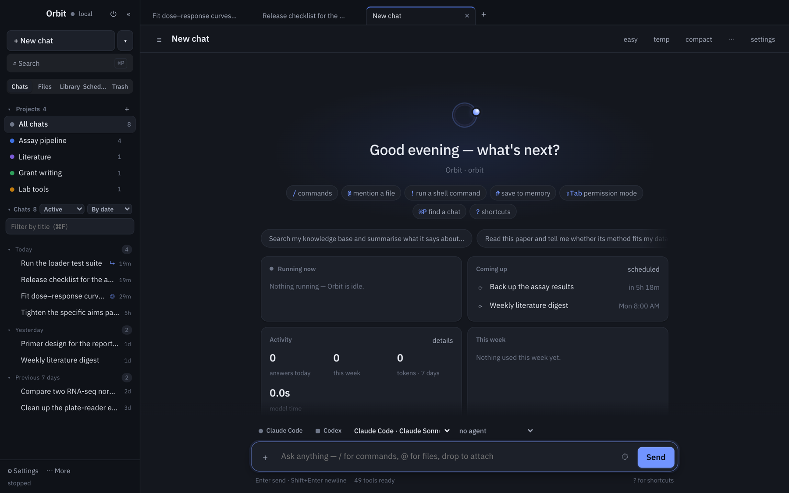</p>

---

<a id="the-desktop-app"></a>
## Orbit for Mac

`desktop/` is Orbit as a Mac app, around the same interface:

- a window of its own, with the chat tabs where the title bar was;
- a menu bar icon listing the chats answering or waiting for you, and the Dock badge counting them;
- a notification when an answer is ready or a chat needs your approval — click it to open that chat;
- **Quick Ask** on ⌥Space from anywhere: Enter asks in a new chat, ⌘Enter asks in the background and tells you when the answer is in;
- `orbit://chat/<id>` links, and `orbit://new?text=…` to start a message (it fills the box; it never sends by itself);
- the full menu: ⌘N new chat, ⌘P palette, ⌘B sidebar, `Ctrl+\`` terminal, ⌘. stop, ⌘⇧E export the chat as PDF, ⌘1–9 tabs;
- launch at login, and staying in the menu bar when the window closes.

It starts Orbit's server when it is not running — through its launchd agent if there is one — and never a second copy.

**Install:** download `Orbit-<version>-arm64.dmg` from the
[latest desktop release](https://github.com/Micropeptide/Orbit/releases?q=desktop&expanded=true),
open it and drag Orbit to Applications. It is not notarized, so the first time right-click
it → **Open** (or run `xattr -dr com.apple.quarantine /Applications/Orbit.app`). Apple
Silicon Macs; Orbit itself (the server) must be installed as described in [Install](#install).

**Updates:** Settings → General → *Orbit for Mac*, or Orbit → Updates in the menu bar:
install automatically (when no chat is answering and you are away, or when you quit), tell
you and let you install, or never check by itself; check every hour, 6 hours, day or week;
beta versions optional. Downloads are checked against the release's `SHA256SUMS.txt`.

```bash
cd desktop && npm install
npm run dist          # build dist/mac-arm64/Orbit.app (built with Electron)
npm run release       # the dmg, the zip the updater uses, and SHA256SUMS.txt
```

---

## Safety

This matters when a model can run code on your machine.

- **Destructive commands are blocked or gated.** `rm -rf` at a protected path is refused
  outright in every mode; recursive deletes, disk operations, history rewrites, `sudo`,
  piping a download into a shell and reading the keychain need your approval, per call.
  Ordinary work (`ls`, `git push`, `samtools`, `curl … | jq`) is not nagged.
- **Autonomy is yours to set** — ask every time, auto-approve safe workspace-scoped
  actions, or full computer access. In Claude Code mode Claude's own permission modes and
  rules decide, and its prompts come to Orbit.
- **Python cannot be used as a shell** when shell is off; **writes are confined** to the
  workspace unless you allow otherwise, `../` included.
- **Untrusted content is fenced.** Web pages, fetched files and other agents' notes are
  wrapped and scanned for prompt injection.
- **Keys stay on the Mac.** API keys are sent only to their provider; for Claude Code on
  other providers the gateway adds the key, so it never enters the Claude process; remote
  machines reach the gateway through a token-protected tunnel.
- **Links in chats never run programs.** Apps and scripts named in a chat are only shown
  in Finder.
- **The server refuses cross-site requests**, and remote access (the phone) is off until
  you pair a device, with a token on every request.
- **A grant can be smaller than forever.** "Yes, and stop asking" used to mean writing a
  permanent rule, when what you usually mean is "for the next twenty minutes". *Yes, and
  for the rest of this chat* holds it for that chat and not one message longer, and nothing
  is written to your settings. In a chat that belongs to a project there is a third size —
  *yes, and allow it in <project>* — which lives with that project's folder rather than
  everywhere; "let pytest run here" is the natural size of that grant, and it used to be
  sayable only for every folder at once.
- **Undoing looks before it leaps.** *Rewind chat + files* first says what it would do to
  each file. One you edited yourself since the answer wrote it stops the whole restore —
  a half-undone folder is worse than one left alone — and going past that is its own
  button.
- **Deletes are reversible.** Chats, files and documents go to a recycle bin; config files
  keep their last 20 versions.

Full rules: [docs/safety.md](docs/safety.md).

---

## On your phone

The Mac stays the source of truth; the iPhone app is a window onto it — the same chats,
live, with the same model picker and a Files tab.

- The same home page on a new chat: running now, coming up, activity and allowances.
- Chats grouped by day, with Claude Code, Codex and OpenCode sessions in their own
  sections; pin, archive, rename, bin; filter by project; search titles and every
  message and jump to the line.
- Answers streamed in Claude Code's style: tool calls as `⏺` lines, look-ups folded,
  a live status line, approvals and questions answered from the phone. Scroll up while
  it writes and it leaves you there, with a "New messages" button.
- The message queue: send while a chat is answering and it waits its turn; reorder,
  edit, pause, or slip a note into the running answer.
- The model picker with what is left of each account and the cheaper hours; `/tasks`,
  scheduled messages and tasks, cluster jobs.
- Photos, camera and files as attachments; plots, math and diagrams render inline;
  file cards under answers; share as PDF or image.
- Start, stop or switch the local model server; set the default model.
- Easy mode per chat, the review and the completion check under each answer, and the
  approval choices that last only as long as the chat or only inside its project.
- Approvals answered from the Lock Screen: Allow or Deny on the notification itself,
  without unlocking into the app.
- A rail down the right edge you can scrub through a long conversation, thinking that
  opens while it thinks and folds away when the answer starts, and code that keeps its
  own text size so reading an answer bigger does not reflow every diff.
- The branch, what is uncommitted and how far it is from upstream, under the chat's title;
  and the file-by-file account of a rewind before it happens.
- If the phone loses the connection mid-answer the Mac carries on and the app rejoins.

- Cluster, Crew and Helpers screens, and the host controls for shared projects, so most of what you do at the Mac
  you can also do from the phone ([the full list](docs/PARITY.md)).
- Pairing tells you what went wrong ("Pairing with your Mac…", then the real reason) instead of a message that vanishes.

Turn it on in **Settings → Phone**, choose how the phone reaches the Mac, and scan the QR:

| | |
|---|---|
| **Internet (no Tailscale)** | works on any network with no VPN app; Cloudflare Tunnel and Access on your own domain ([below](#the-internet-door)) |
| **Tailscale** | anywhere, HTTPS through Tailscale Serve |
| **Local network** | at home, over Wi-Fi |

If scanning does nothing, **Copy a pairing link** in the same panel gives the address to open in the phone's Orbit app.

<p align="center">
&nbsp;&nbsp;</p>

The app lives at [Micropeptide/Orbit-iOS](https://github.com/Micropeptide/Orbit-iOS), with
an unsigned IPA in its [releases](https://github.com/Micropeptide/Orbit-iOS/releases/latest)
for sideloading, or build it from `ios/` with Xcode. Details in
[docs/phone.md](docs/phone.md) and [docs/tailnet-playbook.md](docs/tailnet-playbook.md).

## The internet door

Reach Orbit from the phone on any network, without Tailscale. [docs/INTERNET_DOOR.md](docs/INTERNET_DOOR.md) has the setup and
the reasoning; in short, six locks:

1. **No open port.** `cloudflared` on the Mac dials out to Cloudflare; nothing listens on the router.
2. **Cloudflare Access** in front of the name lets through only your email (a one-time code, for a browser) and one service
   token for the phone app. Anything else stops at Cloudflare's edge.
3. **Orbit checks Access too.** A request naming the tunnel's host must carry Cloudflare's signed token for this application
   (signature, audience, issuer, expiry); one that skipped Access is refused by Orbit itself.
4. **Orbit's own pairing.** Each device still needs the token from the QR; a chats-only device cannot open settings.
5. **Never mistaken for local.** A request through the tunnel is not treated as you at the Mac, whatever headers a proxy sets.
6. **Off means off.** Phone access to Off and everything not from this Mac is refused.

You need a domain on Cloudflare and a token that may edit Tunnel and Access. `bin/orbit-tunnel setup`, `status`, `rotate` and
`remove` do the rest, and the app's page views get through Access with a cookie Orbit hands the paired phone.

---

## Install

Requires macOS and Python 3.9+. Apple Silicon only for the local model; everything else
works on any Mac.

```bash
git clone https://github.com/Micropeptide/Orbit.git
cd Orbit
./install.sh
```

The installer makes a virtualenv, installs dependencies, creates your data folders,
copies default settings (never overwriting existing ones), and links `orbit` and `ob`
into `~/bin`. It is safe to re-run. Then:

```bash
orbit --ui
```

which opens `http://127.0.0.1:8899`.

**Nothing else is required to start.** With no local model and no key, pick a CLI model
if you have `claude` or `codex` installed, or add a key in **Settings → Models & keys**.

**Optional pieces**

- **The local model:** install [MTPLX](https://github.com/Youssofal/MTPLX), download a
  model through it, and re-run `./install.sh`. Tuning (context window, KV quantization,
  speculative decoding, fan mode): [docs/models.md](docs/models.md).
- **Claude Code mode:** install [Claude Code](https://docs.anthropic.com/en/docs/claude-code)
  (`claude` on your PATH). For your subscription, sign in with `claude auth login`, or run
  `claude setup-token` and paste the token under *Claude · your subscription*.
- **Chats on another machine:** a host in `~/.ssh/config` with key-based login and Claude
  Code installed there.

---

## First ten minutes

1. **Tell it who you are.** Settings → Memory → *General instructions* (or, in Claude Code
   mode, your `CLAUDE.md`). Two or three sentences: your field, how you want answers.
2. **Add a provider.** Settings → Models & keys: paste a key (OpenCode Go covers many
   open models at once) and press **test**.
3. **Give it your papers.** Library → Knowledge → add documents, then ask something only
   they know.
4. **Try Claude Code mode.** Flip the switch in the top bar, pick a provider and model,
   choose a folder with the chip by the title, and ask it to change something there.
5. **Make a project.** Group related chats; project instructions apply to all of them.
6. **Hand work to another chat.** Ask it to start a chat on a cheaper model for a routine
   part of the job and wait for the answer.
7. **Read the guide.** Type `/guide`. It opens on a page like this one:

<p align="center">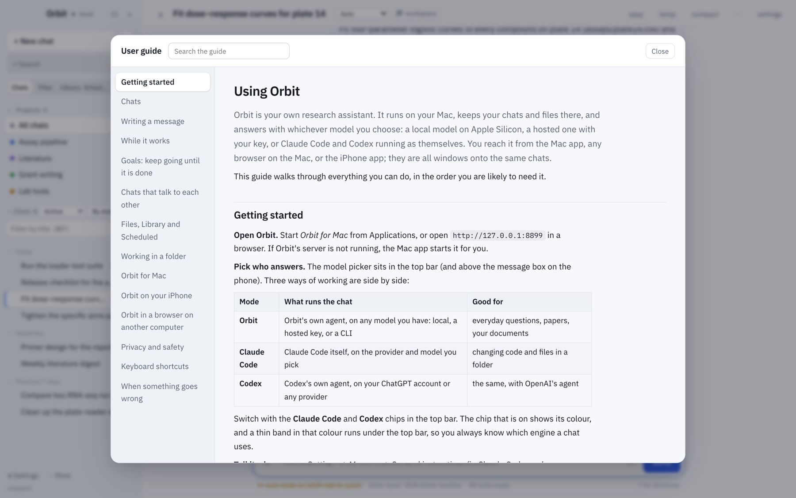</p>

---

## Where your data lives

Everything is inside the install folder — one directory to back up, inspect or delete.
Set `ORBIT_HOME` to keep data somewhere other than the code.

```
config/      settings, agents, projects, schedule, MCP, secrets, instructions,
             provider registry (harness.json), gateway token and usage (claude/)
memory/      durable facts for Orbit's own chats
skills/      Orbit's procedures loaded on demand
knowledge/   your documents, indexed for search
sessions/    your chats, one JSON file each (queued messages included)
workspace/   files Orbit creates; the only place its agent may write by default
uploads/     files you attach
trash/       deleted items, restorable
logs/        model server, safety decisions, usage ledger, Claude Code runs
```

Claude Code's own data stays where Claude keeps it (`~/.claude`), and other agents' where
they keep theirs; Orbit reads it and writes Claude settings, skills and memory only when
you change them.

---

## Configuration

Everything is editable in Settings; the files are plain JSON if you prefer. A selection:

| Setting | Default | What it does |
|---|---|---|
| `max_tool_rounds` | 0 | Tool calls one answer may make. 0 = no limit. |
| `max_turn_minutes` | 0 | Minutes one answer may run. 0 = no limit. |
| `long_run_notice_min` | 30 | A progress notice every N minutes of a long answer. |
| `max_parallel` | none | A cap on chats answering at once, if you want one (the local model always takes turns). |
| `one_chat_at_a_time` | true | On the local model, answers wait in line rather than run side by side. |
| `resume_after_restart` | true | If Orbit stops mid-answer, pick the work up again in the same chat. |
| `keep_awake` | true | Hold off idle sleep while an answer runs. |
| `autocompact_pct` | 80 | Context fullness that triggers trimming (Orbit's own chats). |
| `idle_min` | 90 | Minutes before the local model server is stopped. |
| `trash_days` | 30 | Retention before the recycle bin auto-purges. |
| `shell_enabled` | false | Whether Orbit's agent may run shell commands at all. |
| `write_any` | false | Whether its writes may leave the workspace. |
| `agent_history` | true | List Codex and OpenCode sessions in the sidebar. |
| `claude_qwen.permission_mode` | auto | Permission mode for new Claude Code chats. |
| `claude_qwen.default_host` / `default_dir` / `default_effort` | — | Where new Claude Code chats run, their folder, reasoning effort. |
| `claude_qwen.profile` | standard | `standard`: Claude as you set it up; `lean`: built-in tools and skills only. |

---

## Running it as a background service

So the web app is always there and survives a crash or a logout:

```bash
cp docs/launchagent.plist ~/Library/LaunchAgents/com.orbit.ui.plist
# edit the two paths inside, then:
launchctl load ~/Library/LaunchAgents/com.orbit.ui.plist
```

Details, including the idle watchdog that stops the local model when unused:
[docs/service.md](docs/service.md).

---

## Tests

```bash
venv/bin/pip install pytest        # once
venv/bin/python -m pytest tests/ -q -p no:cacheprovider
```

About a thousand tests, none needing a model, a key or the network: the core agent loop, safety,
sessions and ordering, the provider registry, the gateway's translations and account failover
(Claude, OpenCode Go and Gemini accounts, thought signatures), the look-tools server against a
real Chrome, the message queue, scheduled messages and tasks, model fallback, Codex mode against
a stand-in app-server, the Responses gateway translations, concurrent chats, finding and
previewing the files a chat names, Codex/OpenCode/Antigravity session import and resume with
stand-in CLIs, the SSH wrapper and its watchdog, and Claude Code end to end — the real `claude`
binary against a scripted stand-in for the Messages API. `tests/test_api.py` and
`tests/test_endpoints.py` are for a running app (`venv/bin/python tests/test_api.py`): pytest skips
the first, which creates and removes real data.

---

## Troubleshooting

**`orbit: command not found`** — `~/bin` is not on your PATH. Add
`export PATH="$HOME/bin:$PATH"` to `~/.zshrc`, or run `./bin/orbit` directly.

**The first message after a pause takes ~15 seconds** — the local model server sleeps
when idle and reloads its weights. Raise `idle_min` if it bothers you.

**A provider's test fails** — check the key under Settings → Models & keys (and the region,
where there is one). For OpenCode Go, the account's usage is shown there: a used-up window
says when it resets.

**"Claude · your subscription" says not signed in** — run `claude setup-token` in a
terminal and paste the token under that provider, then press *check again*.

**A chat on another machine will not start** — Settings → Claude Code → Remote machines →
*check* shows what is missing (the host unreachable, no Claude Code there, the process
limit nearly reached). Clusters may briefly block an address after many connections.

**A CLI model is missing from the picker** — Orbit looks on `PATH` plus the usual install
locations; symlink yours into `~/.local/bin` if it is elsewhere.

**Something looks stale after an update** — a banner appears when the code on disk is
newer than the running process; click *Restart interface*.

---

## Documentation

| | |
|---|---|
| [docs/claude-code-engine.md](docs/claude-code-engine.md) | Claude Code mode, providers and the gateway, accounts and usage, SSH chats, other agents' sessions |
| [docs/models.md](docs/models.md) | The local model: MTPLX, context, quantization, fans |
| [docs/safety.md](docs/safety.md) | The safety rules and how to change them |
| [docs/extending.md](docs/extending.md) | Tools and plugins in one Python file |
| [docs/phone.md](docs/phone.md) · [docs/tailnet-playbook.md](docs/tailnet-playbook.md) · [docs/INTERNET_DOOR.md](docs/INTERNET_DOOR.md) | The iPhone app and remote access (Tailscale, Wi-Fi, Cloudflare Tunnel) |
| [docs/PARITY.md](docs/PARITY.md) | Every Mac feature and its state on the phone |
| [docs/claude-science-skill](docs/claude-science-skill) · [docs/claude-science-instructions.md](docs/claude-science-instructions.md) | Using Orbit as a helper from Claude Code, Claude Science or Codex |
| [docs/collab/](docs/collab/) | Shared projects: design, protocol, threat model |
| [docs/cluster-models.md](docs/cluster-models.md) · [docs/SANDBOX.md](docs/SANDBOX.md) | Running a model on a cluster; the simulated cluster for trying it |
| [docs/service.md](docs/service.md) | Running as a background service |
| [docs/answers-files-ideas.md](docs/answers-files-ideas.md) | 200 ideas for answers, files, previews and scheduled messages — which are built |
| [docs/claude-code-harness-ideas.md](docs/claude-code-harness-ideas.md) · [docs/agent-roadmap.md](docs/agent-roadmap.md) | What has been built, what is next, and why |

---

Built by **Runtian Wu** · MIT licensed · [runtianwu.com](https://runtianwu.com) · [github.com/Micropeptide](https://github.com/Micropeptide)
